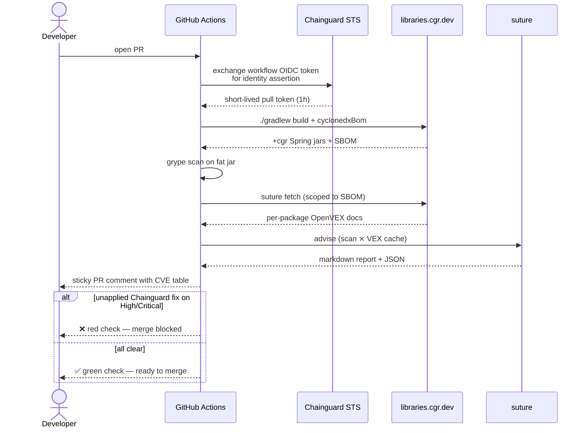
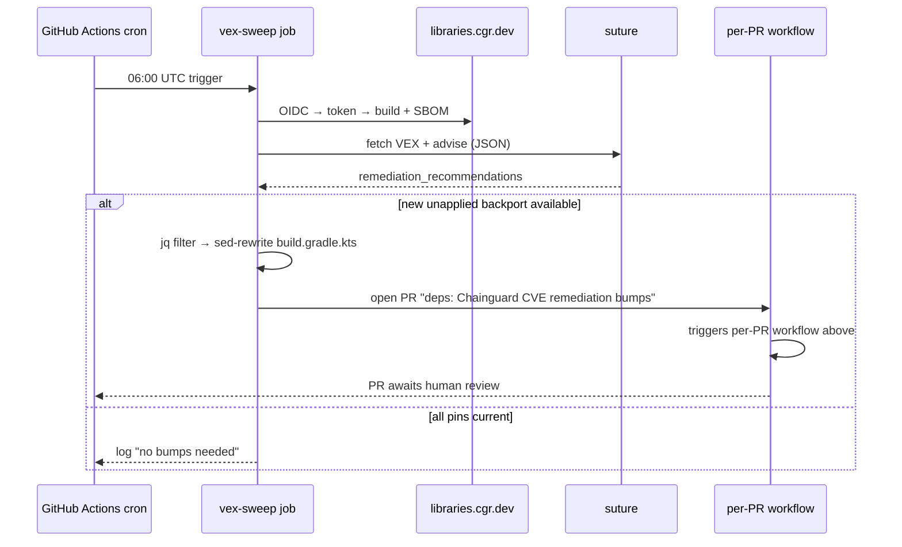

# chainguard-spring-reference

A small, working Spring Boot application that resolves its entire
dependency graph from [Chainguard Libraries](https://libraries.cgr.dev)
and uses the Chainguard OpenVEX feed to gate CI on unapplied CVE
remediations.

**This is a reference, not a framework.** Every file in the repository
exists to demonstrate exactly one thing. The code is intentionally small
so you can read all of it in an afternoon, change parts of it, and watch
what happens.

If you're evaluating Chainguard Libraries for a Java shop, start here:

- Local build and CVE scan under 5 minutes (quickstart below)
- Full CI with VEX-anchored gating in ~15 minutes (needs one Chainguard
  identity set up for OIDC federation)

**Use this as a starting point.** Click **Use this template** at the top
of the repo page to create your own copy in one click, or `git clone`
and strip the parts you don't need.

---

## Quickstart (3 commands, ~5 minutes)

Prerequisites: JDK 21 and a Chainguard organization with the Java
entitlement enabled.

```bash
# 1. Mint a pull token (replace <your-org-uidp> with your Chainguard org UIDP)
eval "$(chainctl auth pull-token --repository=java --ttl=24h --parent=<your-org-uidp> --output env)"

# 2. Build + run the tests (resolves everything from libraries.cgr.dev)
./gradlew build

# 3. Run the app
./gradlew bootRun
# in another terminal:
# curl -s http://localhost:8080/version | jq
# -> {"springFramework":"6.2.19-0","springBoot":"3.5.14-0.cgr.1"}
```

If `./gradlew build` passes, you've just resolved Spring Framework
6.2.19, Spring Boot 3.5.14, and Spring Security 6.5.11 as Chainguard
+cgr builds end-to-end.

Want the CI integration too? Jump to [Set up CI (one-time)](#set-up-ci-one-time).

---

## What this demonstrates

1. **How a Gradle project consumes Chainguard Libraries.** Two Maven
   repositories, pull-token credentials from environment variables, no
   `mavenCentral()` fallback. See `settings.gradle.kts`.

2. **How the `-0.cgr.N` version suffix works.** Chainguard appends a
   remediation revision to every build. See the comments in
   `build.gradle.kts` and the `/version` endpoint's output.

3. **How to override the Spring Boot BOM.** Boot 3.5.14's BOM pins
   Framework to 6.2.18 and Security to 6.5.4. If you want 6.2.19 or
   6.5.11, you override explicitly. See the `ext["spring-framework.version"]`
   line in `build.gradle.kts`.

4. **How to prove the integration actually works.** The test in
   `ApplicationTests.java` boots the full Spring context against the
   Chainguard-provided jars and asserts the runtime Spring versions.
   A green test is end-to-end proof.

5. **How CI gates on unapplied CVE remediations.** The
   `.github/workflows/build.yml` scans the fat jar with Grype, cross-
   references the Chainguard OpenVEX feed via
   [`suture`](https://github.com/mental-lab/suture), and fails the merge
   if a backport is available but not applied.

6. **How to adopt new remediations automatically.** The
   `.github/workflows/vex-sweep.yml` runs nightly and opens a PR when a
   new `-0.cgr.N` revision ships that fixes a currently-open CVE.

7. **How to run all of this without storing Chainguard credentials in
   the repository.** The CI uses GitHub OIDC federation to mint short-
   lived tokens on every run.

---

## What you'll see

### Local — `./gradlew test`

```
> Task :test
ApplicationTests > contextLoadsFromChainguardJars() PASSED
ApplicationTests > runtimeReportsExpectedSpringVersions() PASSED
BUILD SUCCESSFUL
```

If this passes, the integration is wired end-to-end: dependency
resolution against `libraries.cgr.dev`, pull-token auth, BOM-driven
transitive resolution, and Spring Boot context startup against the
`+cgr` artifacts.

### Local — `./gradlew dependencies --configuration runtimeClasspath`

Look for the override pattern on Spring Framework:

```
+--- org.springframework.boot:spring-boot-starter-web -> 3.5.14-0.cgr.1
     +--- org.springframework.boot:spring-boot:3.5.14-0.cgr.1
     \--- org.springframework:spring-core:6.2.18 -> 6.2.19-0.cgr.1
```

The `6.2.18 -> 6.2.19-0.cgr.1` arrow is the proof the BOM override
worked. Boot's BOM asked for 6.2.18; the `ext["spring-framework.version"]`
override told Gradle to resolve 6.2.19 instead; `libraries.cgr.dev`
served the +cgr-remediated build of that version.

### Local — `./gradlew bootRun` then `curl /version`

```json
{ "springFramework": "6.2.19-0", "springBoot": "3.5.14-0.cgr.1" }
```

The runtime version API returns the Chainguard suffix because that's
what's embedded in the jar manifest. Spring itself can't tell it's a
remediated build — because by design, remediated builds are drop-in
replacements.

### CI — PR comment from the suture gate

Every pull request gets a sticky comment with the CVE table:

```
19 findings — ✅ 16 already remediated · 🔧 0 with Chainguard fix ready · 📋 3 exception-review
```

If a Chainguard fix exists for a High/Critical finding and the PR
hasn't adopted it, the `--gate` flag flips the CI check red and
blocks merge.

### CI — nightly sweep opens a PR

```
Title: deps: Chainguard CVE remediation bumps
Body:
  Chainguard shipped fixes for CVE-2026-47890 on your pinned
  Spring versions.

  Changes:
    - spring-webmvc:  6.2.19-0.cgr.1 → 6.2.19-0.cgr.2
```

That PR immediately triggers the per-PR workflow, which comments the
suture advice confirming the delta. The audit trail is self-documenting.

---

## How the CI works

### What happens on every PR



### What happens nightly



The two flows compose: the nightly sweep opens the PR, and the per-PR
workflow immediately scans it and posts the suture advice comment
confirming the CVE delta. By the time a human reviewer looks at the
bot's PR, the audit trail is already attached.

---

## Walk the code

Open these files in order and read the inline comments. Each is doing
one thing.

### 1. [`settings.gradle.kts`](settings.gradle.kts) — repository wiring

**What to notice:**

- Two Maven repos: `java-remediated` for +cgr builds, `java` as the
  mirror for upstream.
- Credentials from environment variables, not hardcoded.
- `repositoriesMode.FAIL_ON_PROJECT_REPOS` prevents a `build.gradle.kts`
  somewhere else from adding `mavenCentral()` and bypassing Chainguard.

### 2. [`build.gradle.kts`](build.gradle.kts) — Boot BOM + Framework override

**What to notice:**

- `spring-boot-dependencies:3.5.14-0.cgr.1` imported as the BOM.
- `ext["spring-framework.version"] = "6.2.19-0.cgr.1"` — the one line
  that moves Framework from Boot's default of 6.2.18 to 6.2.19.
- `spring-security-*:6.5.11-0.cgr.1` pinned explicitly for the same
  reason (Boot's BOM pins Security to 6.5.4).
- The `org.cyclonedx.bom` plugin for SBOM generation that suture reads.

### 3. [`src/test/java/dev/chainguard/example/ApplicationTests.java`](src/test/java/dev/chainguard/example/ApplicationTests.java) — runtime proof

**What to notice:**

- `@SpringBootTest` boots the full context. If any Chainguard-provided
  jar were broken, this would fail.
- The version assertions use `startsWith("6.2.19")` because
  `SpringVersion.getVersion()` includes the `-0` prefix of the cgr
  suffix. Comment explains why.

### 4. [`.github/workflows/build.yml`](.github/workflows/build.yml) — CI auth and gate

**What to notice:**

- `permissions: id-token: write` enables GitHub OIDC.
- `chainguard-dev/setup-chainctl` exchanges that OIDC token for a
  Chainguard identity assertion.
- `chainctl auth pull-token --ttl=1h` mints a 1-hour pull token on
  the fly and exports it to `$GITHUB_ENV` with a mask.
- `vex-advice` composite action handles scan + advise + gate.
- `marocchino/sticky-pull-request-comment` keeps the per-PR comment
  updated in place rather than spamming new comments.

### 5. [`.github/actions/vex-advice/action.yml`](.github/actions/vex-advice/action.yml) — shared composite

**What to notice:**

- Installs Grype and suture.
- Scans the fat jar, builds the VEX cache scoped to the SBOM, calls
  `suture advise` twice (markdown for humans, JSON for automation).
- Both the per-PR workflow and the nightly sweep call this action, so
  there's one place to pin the suture version.

### 6. [`.github/workflows/vex-sweep.yml`](.github/workflows/vex-sweep.yml) — nightly bump bot

**What to notice:**

- Runs on a cron, has `pull-requests: write`.
- The bump step parses suture's JSON output with `jq` — look at the
  `.remediation_recommendations[] | select(.action == "backport" and
  (.fix_applied | not))` filter.
- `peter-evans/create-pull-request` opens the PR with the suture
  advice report as the body.

### 7. [`renovate.json`](renovate.json) and [`.github/dependabot.yml`](.github/dependabot.yml) — version watchers

**What to notice:**

- Both configured to watch `libraries.cgr.dev` as a Maven registry.
- Renovate has explicit `"versioning": "loose"` for predictable
  behavior on the cgr suffix.
- The two bots solve a different problem than suture — they tell you
  "a new version exists," suture tells you "and it fixes CVE-X."

---

## Try it

### Prerequisites

- JDK 21 (`brew install openjdk@21` on macOS; set `JAVA_HOME` accordingly)
- A Chainguard pull token for Java (see below)

### Mint a pull token

```bash
chainctl auth pull-token \
  --repository=java \
  --ttl=24h \
  --parent=<your-org-uidp> \
  --output env
```

That prints `CHAINGUARD_JAVA_IDENTITY_ID=` and `CHAINGUARD_JAVA_TOKEN=`
exports. Run them in your shell (or wrap the command with `eval "$(...)"`).

### Run the build

```bash
./gradlew build
```

A green build proves the pull-token auth works and the Spring stack
resolves against the Chainguard-provided jars.

### Run the app

```bash
./gradlew bootRun
# in another terminal:
curl -s http://localhost:8080/version | jq
curl -su demo:demo http://localhost:8080/hello
```

### Scan the fat jar locally

```bash
./gradlew bootJar cyclonedxBom
grype build/libs/*.jar
```

The scan should surface the usual noise of transitive libraries, but
every Spring finding should be absent — because the +cgr builds already
remediated them.

### Install suture and advise

```bash
# Install:
curl -sSfL \
  https://github.com/mental-lab/suture/releases/latest/download/suture_$(uname -s | tr '[:upper:]' '[:lower:]')_$(uname -m | sed 's/x86_64/amd64/;s/aarch64/arm64/').tar.gz \
  | tar xz suture
sudo install suture /usr/local/bin/

# Fetch the VEX cache scoped to this project:
mkdir -p data results
suture fetch --sbom build/reports/application.cdx.json --out data/vex-cache.json

# Scan + advise:
grype build/libs/*.jar -o json > results/jar-scan.json
suture advise --scan-dir results/ --cache data/vex-cache.json --format markdown --out vex-report.md
cat vex-report.md
```

---

## Change something

### Introduce an unpatched version

Edit `build.gradle.kts`. Change the Framework override from
`6.2.19-0.cgr.1` to `6.2.19`:

```diff
-ext["spring-framework.version"] = "6.2.19-0.cgr.1"
+ext["spring-framework.version"] = "6.2.19"
```

The build will probably fail (upstream 6.2.19 isn't in the Chainguard
Maven proxy without the suffix), or if it resolves via the mirror,
grype will show CVE-2026-47884 as unfixed and suture will mark it as
`backport` with the available fix.

### Change the BOM version

Change the Boot BOM pin to a different cgr revision — say,
`3.5.14-0.cgr.2` once that ships. Watch `./gradlew dependencies` show
the new resolution.

### Fail the CI gate

Pin a Spring library to a version that has an unapplied Chainguard
fix. Push a PR. The CI check turns red, the sticky comment shows the
specific CVE and the suggested bump.

---

## Set up CI (one-time)

The in-repo workflows use GitHub OIDC federation to authenticate to
Chainguard without storing long-lived credentials.

**1. Create a Chainguard identity trusting this repo.** Replace
`<org-uidp>` with your organization's UIDP from
`chainctl iam organizations list`:

```bash
chainctl iam identities create "spring-reference-ci" \
  --parent <org-uidp> \
  --identity-issuer https://token.actions.githubusercontent.com \
  --subject-pattern "^repo:<your-github-user>(@[0-9]+)?/chainguard-spring-reference(@[0-9]+)?:ref:refs/heads/main$" \
  --role libraries.java.pull_token_creator
```

**Why `--subject-pattern` instead of `--subject`:** GitHub's workflow
OIDC `sub` claim now includes stable numeric IDs for the owner and
repo (e.g. `repo:mental-lab@57370621/chainguard-spring-reference@1439052290:...`).
The pattern above accepts either the legacy or the immutable format,
locked to the `main` branch — it doesn't widen the trust surface, it
just accepts both subject formats GitHub might send.

**Why `libraries.java.pull_token_creator` instead of `viewer`:** minting
a short-lived library pull-token requires `identity.create` capability
(the mint operation internally spawns a scoped child identity). The
`viewer` role is read-only and lacks this. `libraries.java.pull_token_creator`
is the managed Chainguard role that bundles exactly what pull-token
minting needs — `identity.create`, `libraries.entitlements.list`,
`libraries.java.list`, and the role-binding plumbing.

The command prints the identity UIDP.

**2. Set two repository variables.** These are identifiers, not
secrets — safe to be visible:

```bash
gh variable set CHAINGUARD_IDENTITY \
  --repo <your-github-user>/chainguard-spring-reference \
  --body "<identity-uidp-from-step-1>"

gh variable set CHAINGUARD_PARENT \
  --repo <your-github-user>/chainguard-spring-reference \
  --body "<org-uidp>"
```

**3. Allow Actions to open pull requests.** The nightly VEX sweep opens
a PR when a new +cgr revision ships that remediates an open CVE.
GitHub repos default to disallowing this.

```bash
gh api repos/<your-github-user>/chainguard-spring-reference/actions/permissions/workflow \
  -X PUT \
  -F default_workflow_permissions=write \
  -F can_approve_pull_request_reviews=true
```

Or via UI: Settings → Actions → General → Workflow permissions → check
"Allow GitHub Actions to create and approve pull requests" → Save.

**4. Trigger the first build:**

```bash
gh workflow run build.yml --repo <your-github-user>/chainguard-spring-reference
```

If the identity trust policy is right, the workflow mints a token and
runs the full build + scan + advise + gate chain.

---

## Automated version management

Three different signals, each solving a different piece of "how do we
know a new +cgr revision shipped and when should we adopt it":

| Tool | What it watches | What it does | Config in this repo |
|---|---|---|---|
| **Renovate** | `maven-metadata.xml` on `libraries.cgr.dev` | Opens grouped PRs for new +cgr revisions; auto-merges patch bumps that pass CI | `renovate.json` |
| **Dependabot** | Same, GitHub-native | Same, lower configurability | `.github/dependabot.yml` |
| **suture** | OpenVEX feed, cross-referenced with scanner output | CVE-anchored signal with per-finding remediation advice; gates CI merges | `.github/workflows/*.yml` + `.github/actions/vex-advice/` |

Pick one of Renovate / Dependabot (not both — they'd race each other
on PRs). Renovate is preferred for Chainguard version suffixes because
it has explicit versioning-scheme control. Suture complements either
one by adding the CVE-anchored audit signal that neither bot provides.

### Credentials for the bots

The in-repo GitHub Actions workflows mint short-lived tokens via OIDC
and don't need stored credentials. Renovate and Dependabot run outside
those workflows and need the pull-token credentials provided
separately:

- Renovate: `CHAINGUARD_JAVA_IDENTITY_ID` and `CHAINGUARD_JAVA_TOKEN`
  as Renovate `hostRules` secrets.
- Dependabot: same values as Dependabot secrets.

Mint a long-lived (365-day) pull token for the bots with:

```bash
chainctl auth pull-token --repository=java --ttl=8760h --parent=<your-org> --output env
```

---

## Extend it

Ideas for what to add next, roughly in order of difficulty:

- **Add a container image.** Pair the +cgr libraries with a Chainguard
  JRE base image (`FROM cgr.dev/chainguard/jre:latest`) to get the
  complete top-to-bottom CVE remediation story.
- **Add integration tests that exercise Spring Security.** Boot the
  context, hit a protected endpoint, assert the 401 — proves Security
  6.5.11 actually works, not just loads.
- **Add a second service** that depends on this one, to see how
  multi-module Gradle resolves +cgr versions across modules.
- **Switch to a different ecosystem.** Suture also handles PyPI and
  npm. Add a Python child project with `cyclonedx-py` generating the
  SBOM and the same suture flow.

---

## FAQ

**Why is the group `dev.chainguard.example`?**
Convention — it's an example application. If you fork, change `group`
in `build.gradle.kts` to whatever matches your publishing coordinates.

**Why Spring Boot 3.5.14 specifically?**
It's a current, supported Boot line with a well-populated Chainguard
catalog. Any supported Boot line should work with the same pattern.

**Does this work with Maven instead of Gradle?**
Yes — the two Chainguard repositories wire into `~/.m2/settings.xml`
with `<repository>` + `<mirror>` + `<server>` blocks. See the
[Chainguard Libraries Maven docs](https://edu.chainguard.dev/chainguard/libraries/java/build-configuration/)
for the exact XML. The Framework/Security override pattern is the
same mechanic in `<properties>` instead of `ext[]`.

**Do I have to use suture?**
No. Grype alone will show you CVE findings; the Chainguard VEX feed
documents the fixes. Suture just stitches them together and emits an
opinionated remediation report. If your security team has a different
reporting pipeline, you can feed the raw VEX JSON (`vex-report.md.json`)
into whatever they prefer.

---

## See also

- [Chainguard Libraries documentation](https://edu.chainguard.dev/chainguard/libraries/)
- [suture](https://github.com/mental-lab/suture) — the OpenVEX-aware
  remediation advisor used in CI
- [chainguard-swag-shop](https://github.com/mental-lab/chainguard-swag-shop)
  — a Python companion to this reference, intentionally vulnerable, wired
  to suture
